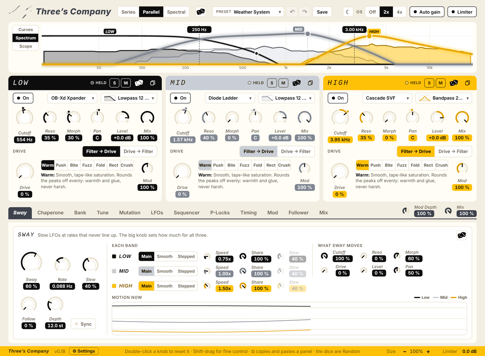
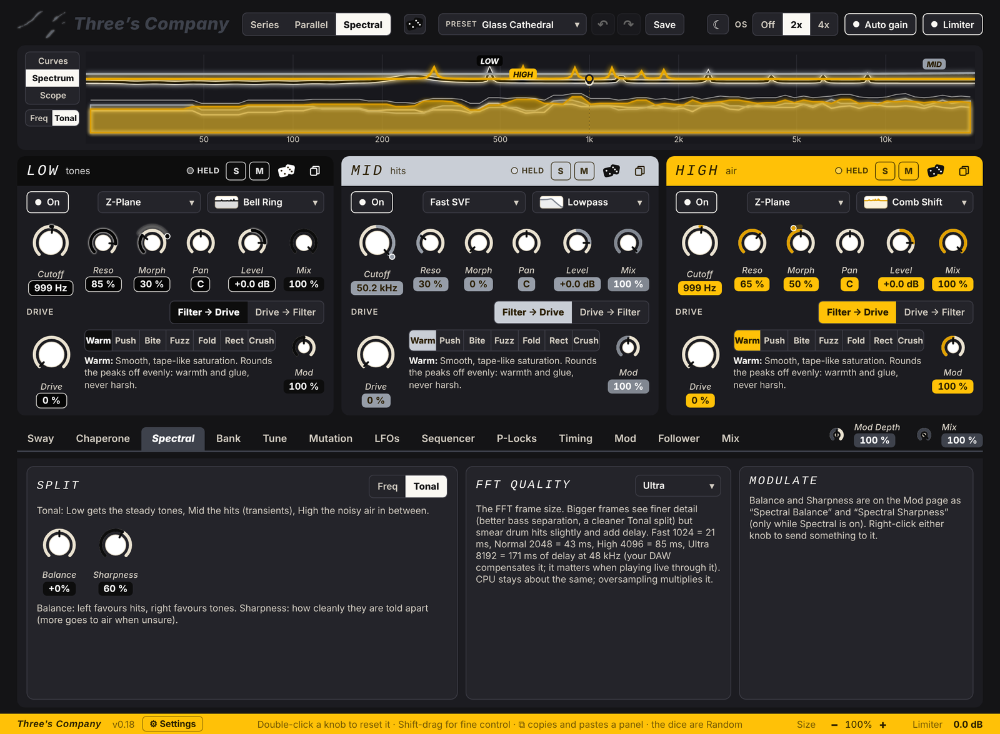
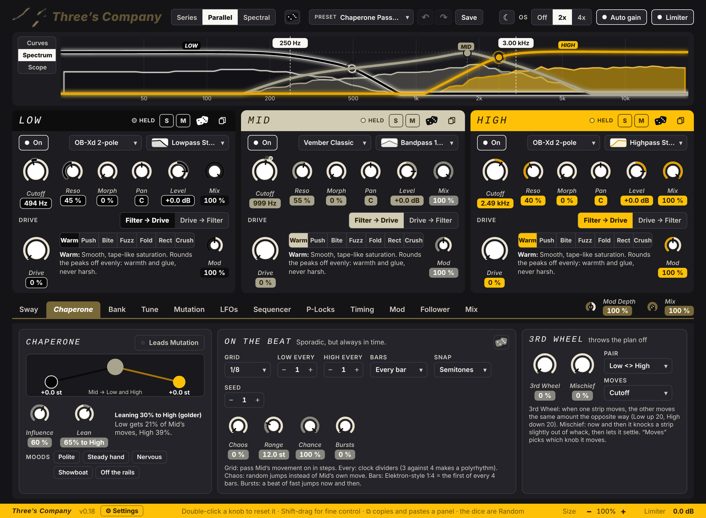
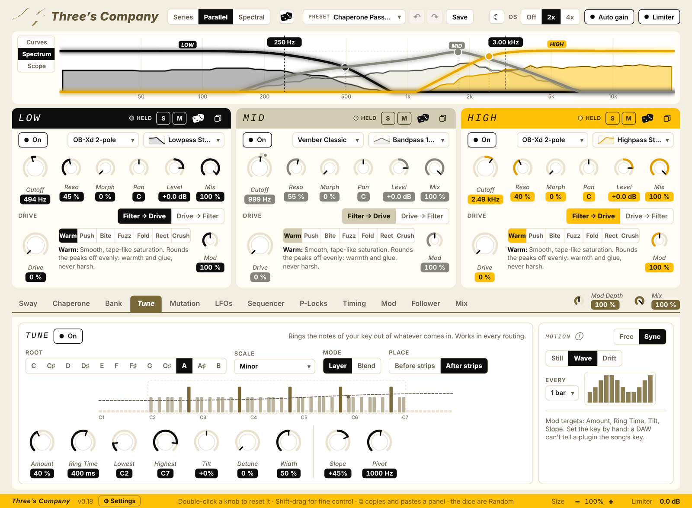
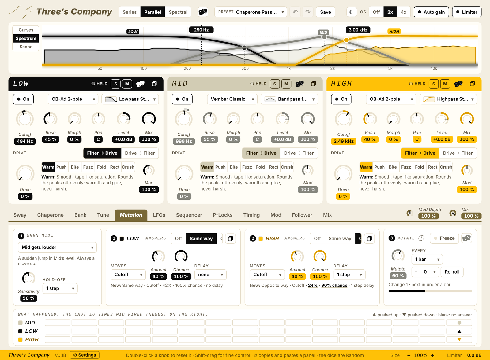

<h1 align="center">Three's Company</h1>

<p align="center">
  <b>Three filters that move together.</b><br>
  A three-strip filter effect by Otis Kanno · CLAP · VST3 · AU · Mac and Windows
</p>

<p align="center">
  <a href="https://github.com/dans314/threes-company/releases/latest/download/Threes-Company-Windows.zip"><b>⬇ Download for Windows</b></a> ·
  <a href="https://github.com/dans314/threes-company/releases/latest/download/Threes-Company-macOS.zip"><b>⬇ Download for Mac</b></a><br>
  <a href="https://dans314.github.io/threes-company/">Download page</a> ·
  <a href="docs/Threes-Company-Quick-Reference.pdf">Quick reference</a> ·
  <a href="docs/Threes-Company-User-Manual.pdf">User manual</a> ·
  <a href="INSTALL.md">Install help</a>
</p>

<p align="center">
  <picture>
    <source media="(prefers-color-scheme: dark)" srcset="docs/images/hero-dark.png">
    
  </picture>
</p>

---

## Welcome

Three's Company splits your sound across three strips, **Low**, **Mid** and **High**, each with its own filter and drive, and gives you lots of ways to make them move. Mid leads. Low and High can follow it in time, answer it back, or drift on their own, so a static loop starts to breathe.

It's made for playing, not just for fixing. Pick a preset from **Start**, hover anything for a tip, and turn knobs.

## What's inside

- **Three strips:** classic analog-style filters or Z-Plane morphing filters, each with seven drive types (Warm, Push, Bite, Fuzz, Fold, Rectify and Crush) before or after the filter.
- **Three routings:** **Series** stacks the strips. **Parallel** gives each strip its own band. **Spectral** splits by frequency, or by character (steady tones, hits and air) with **Tonal**.
- **Movers on every page:** slow **Sway**, the **Chaperone** passing Mid's moves on in time, **Mutation** answering what Mid does, three **LFOs**, a 32-step **Sequencer** with P-locks, an envelope **Follower**, and a 16-slot **Mod** matrix.
- **Tune:** rings the notes of your key out of whatever comes in, with a tilt EQ and motion that can lock to your song.
- **Friendly:** undo and redo, right-click any knob to see what's moving it, save your own presets anywhere, and light and dark themes.

<table>
  <tr>
    <td width="50%"><br><b>Spectral, Tonal mode.</b> Steady tones, hits and air each get their own strip. Here two Z-Plane filters make bell partials and a shifting comb.</td>
    <td width="50%"><br><b>The Chaperone.</b> Mid leads and the Chaperone passes its moves on to Low and High, always in time, with moods from Polite to Off the rails.</td>
  </tr>
  <tr>
    <td width="50%"><br><b>Tune.</b> Narrow resonators on the notes of your key. Pick a root and scale, shape the ringing with Slope, and let Motion sweep through the notes in time with the song.</td>
    <td width="50%"><br><b>Mutation, in three steps.</b> When something happens in Mid, Low and High answer, and Mutate slowly rewrites those answers over the song.</td>
  </tr>
</table>

## Get started in three steps

1. **Download** the zip for your computer: [**Windows 10 / 11**](https://github.com/dans314/threes-company/releases/latest/download/Threes-Company-Windows.zip) or [**Mac** (macOS 11+, Apple Silicon and Intel)](https://github.com/dans314/threes-company/releases/latest/download/Threes-Company-macOS.zip). Older versions are on [Releases](../../releases).
2. **Install:** each zip has a **READ ME FIRST** guide for your computer. In short:
   - **Mac:** `.clap` → `~/Library/Audio/Plug-Ins/CLAP/`, `.vst3` → `~/Library/Audio/Plug-Ins/VST3/`, `.component` → `~/Library/Audio/Plug-Ins/Components/`
   - **Windows:** `.clap` → `C:\Program Files\Common Files\CLAP\`, `.vst3` → `C:\Program Files\Common Files\VST3\`
3. **Play:** rescan plugins in your DAW, add **Three's Company** to a track, and open the **Start** presets. Bitwig: CLAP or VST3 · Ableton Live: VST3 or AU · FL Studio: CLAP or VST3 · Logic: AU.

## Handy to know

| Do this | To |
| --- | --- |
| Double-click a knob | Reset it |
| Shift-drag | Fine adjustment |
| Right-click a knob | See what's moving it, add modulation, copy or paste its value |
| ↶ ↷ or ⌘Z / ⇧⌘Z (Ctrl+Z / Ctrl+Y) | Undo and redo |
| 🎲 dice | Randomize just that card or strip |
| Save | Keep your own preset; it shows up under **Yours** |

The [quick reference](docs/Threes-Company-Quick-Reference.pdf) fits it all on one page, and the [user manual](docs/Threes-Company-User-Manual.pdf) covers every page in detail.

## Something not right?

Open the plugin, click **⚙ Settings → Copy details**, and send that text along with what happened. It tells me your version, DAW and settings, which makes bugs much quicker to fix.

---

<details>
<summary><b>Building from source</b></summary>

On a Mac with Xcode's command line tools and CMake (`brew install cmake`):

```
sh build-mac.sh        # the CLAP, plus the tests
sh build-all-mac.sh    # CLAP, VST3 and AU, then Apple's AU check
```

`build-mac.sh` should end with `RESULT: PASS`, and `build-all-mac.sh` with `AU VALIDATION SUCCEEDED`. If you change the window (`gui/index.html`), run `python3 tools/embed_gui.py` before building. Every push builds Windows and Mac with GitHub Actions (`.github/workflows/build.yml`), and pushing a tag like `v0.18.1` publishes a Release.

| Path | What it is |
| --- | --- |
| `src/tc_engine.h` | The sound engine |
| `src/tc_clap.cpp` | The plugin: parameters, presets, state and the window bridge |
| `gui/index.html` | The plugin window |
| `src/tc_gui_mac.mm`, `src/tc_gui_win.cpp` | The window on Mac (WebKit) and Windows (WebView2) |
| `tests/` | The engine and plugin tests |

</details>

## Licence

Free software under the GPL v3. The filters are the Surge Synth Team's [sst-filters](https://github.com/surge-synthesizer/sst-filters), and the filter core started from [Two Filters](https://github.com/baconpaul/two-filters) by Paul Walker (BaconPaul), both GPL v3. Thank you to both.
